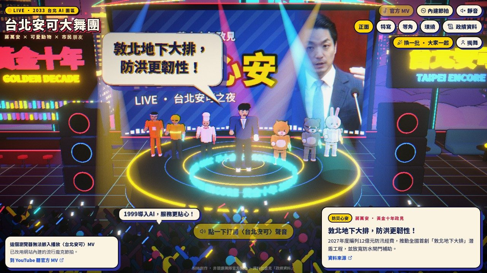
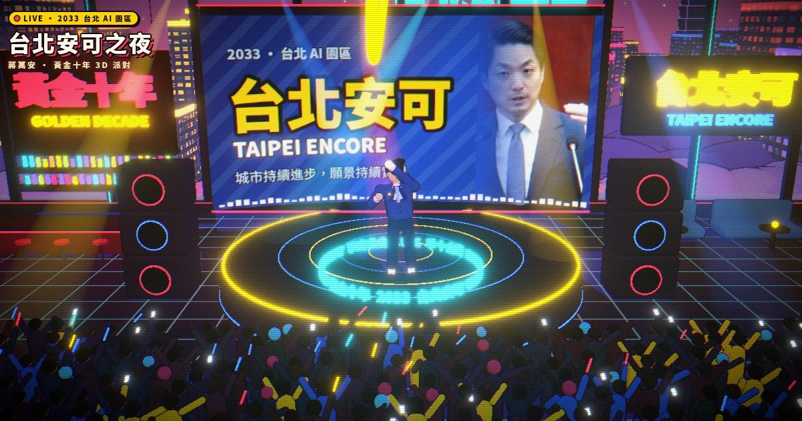
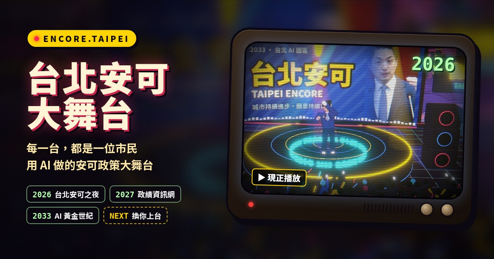
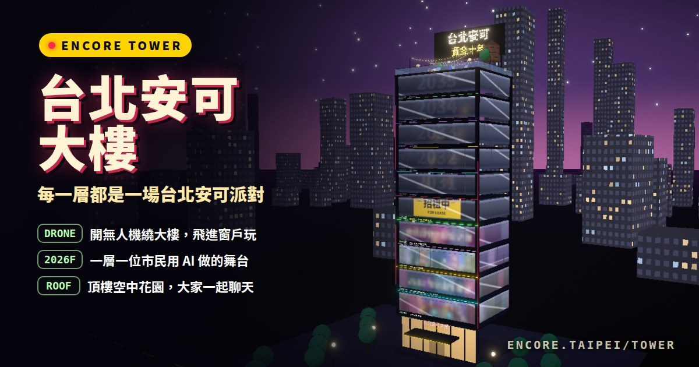
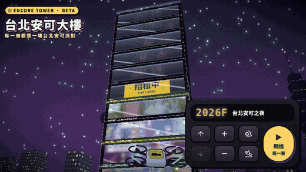
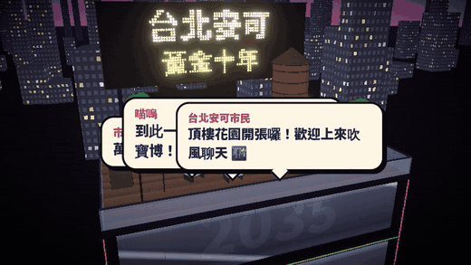
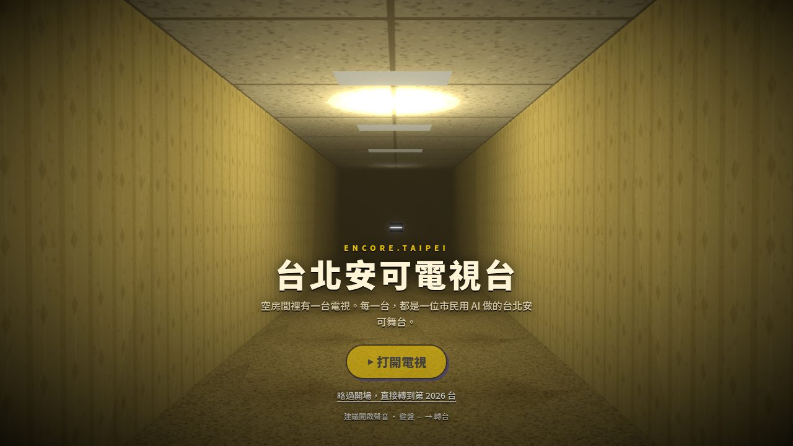
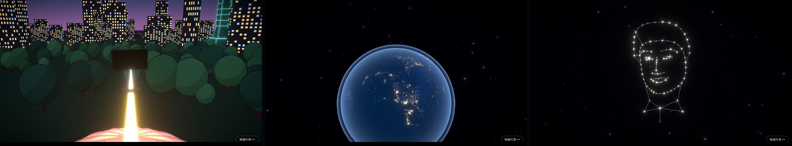

<div align="center">



# 台北安可 ENCORE.TAIPEI

**為台北拼下一個黃金十年：一場市民用 AI 一起蓋的 3D 台北安可派對**

[](https://encore.taipei)
[](https://encore.taipei/beta/)
[](https://encore.taipei/tower/)
[](https://encore.taipei/submit/)

[](LICENSE)


</div>

> [!NOTE]
> 粉絲創作之互動藝術作品，**非蔣萬安競選團隊官方網站**。施政成績與政見每一條都附出處；素材授權見 [CREDITS.md](CREDITS.md)。

免安裝、手機電腦都能玩。三種逛法，同一份熱情：

<table>
  <tr>
    <td width="33%" valign="top">
      <a href="https://encore.taipei"></a>
      <h3><a href="https://encore.taipei">台北安可之夜</a></h3>
      2033 年的台北 AI 園區夜店，市長在台上跳 MJ 舞步，黃金十年政見化成 3D 立體字飛進場，台下群眾喊出四年施政成績。
    </td>
    <td width="33%" valign="top">
      <a href="https://encore.taipei/beta/"></a>
      <h3><a href="https://encore.taipei/beta/">台北安可電視台</a></h3>
      後室裡的一台老電視。看完台灣建設新聞特輯後開始轉台，每一台都是一位市民用 AI 做的台北安可舞台。
    </td>
    <td width="33%" valign="top">
      <a href="https://encore.taipei/tower/"></a>
      <h3><a href="https://encore.taipei/tower/">台北安可大樓</a></h3>
      每一台變成玻璃大樓的一層樓。開無人機繞大樓、飛進窗戶看派對，頂樓空中花園可以和大家聊天。
    </td>
  </tr>
</table>

## 台北安可大樓

<p align="center">
  
  
</p>

- **一層一場派對**：第 2026 台是一樓，往上依序疊，大樓至少蓋到 2035 樓（黃金十年），上架的舞台越多就越高。
- **隔著落地窗看**：每層窗戶裡是那一層舞台的畫面，霧面玻璃、派對燈光與反光，不用同時跑十座 3D 舞台，手機也順。
- **開無人機**：滾輪或上下滑動是上下飛、左右拖曳繞大樓、雙指拉遠拉近；點一層樓，無人機就衝進窗戶，變成那一層的舞台。
- **搭電梯換樓層**：在樓層裡按 ↑ ↓，電梯門關上、「叮」一聲，門打開就是另一場派對；從最高樓再往上就到頂樓。
- **頂樓花園**：串燈、躺椅、火盆、紐約水塔和「台北安可 黃金十年」跑馬燈泡招牌，留言會變成對話泡泡浮在躺椅上。

## 台北安可電視台

<p align="center">
  
  
</p>

1. **後室開場**：黃色壁紙走廊盡頭的老電視「啪」一聲亮起，播出〈台北安可 新聞特輯〉：1974 十大建設、1980 新竹科學園區、
   1987 台積電、2012 美國免簽、2016 北門重見天日、2025 公館圓環改正交路口。電視一路從木頭電視、映像管變成液晶，推進到滿版。
2. **轉台**：漂浮遙控器或鍵盤 ← → 轉台，有雜訊、音效與台號顯示；彩色鍵會傳給舞台，例如叫伴舞上台。
3. **上架你的舞台**：最後一台「訊號徵求中」有「一鍵交給你的 AI Agent」，把完整 prompt 貼給 Claude、Gemini 或 Cursor 就能開工；
   送出網址後立刻能在電視上預覽，管理員審核通過才正式上架。
4. **關機彩蛋**：電視在大安森林公園露天音樂台噴火升空，穿過雲層看見以台灣為中心的地球，星星連成市長的臉眨眼，片尾名單滾動。

<p align="center">
  
</p>

## 台北安可之夜

| 看點 | 內容 |
| --- | --- |
| 舞台 | 卡通 3D 市長角色，40 拍一輪的 MJ 式旋轉、月球漫步與踮腳舞步，跟著節拍跳；電視台版本還能叫可愛動物（橘貓、柴犬、臺灣黑熊、石虎…）與市民伴舞上台 |
| 3D 政見泡泡 | 從 22 條黃金十年政見中輪流挑選，每個字都是擠出成型的 3D 字，從畫面外旋轉飛入 |
| 群眾 | 約 450 位背對鏡頭的人影揮應援棒、錄影，隨機喊出 35 項四年施政成績 |
| 政績資料 | 側欄列出所有政績與政見，**每條附出處連結** |
| 音樂 | 以 YouTube 官方內嵌播放器播放〈台北安可〉官方 MV；無法播放時改用 Web Audio 即時合成的節拍 |
| 畫風 | 參考 Colorfigures 手繪等角插畫：三階平塗明暗、粗墨線輪廓、紙紋顆粒，加上霓虹、Bloom 與體積光 |

## 一起蓋：上架你的舞台

任何人都可以用 AI 做一座自己的台北安可舞台，上架成電視台的一台、大樓的一層：

1. 打開上架頁 **[encore.taipei/submit](https://encore.taipei/submit/)**（或在[電視台](https://encore.taipei/beta/)轉到最後一台、到[大樓](https://encore.taipei/tower/)點「招租中」那一層）。
2. 按「一鍵交給你的 AI Agent」，把 prompt 貼給你的 AI 助手，做好後部署成公開的 `https://` 網址（要允許被 iframe 嵌入）。
3. 貼上網址送出，馬上帶你到電視台預覽；管理員審核通過後所有人都看得到，還會自動產生分享預覽圖。

**上架規範**：內容友善正向，不攻擊、不抹黑任何人或政黨；照片、音樂、字型只用自己做的、公有領域或有授權的素材並標示來源；
頁面上註明「粉絲創作，非官方網站」。不符合規範的作品不會上架。

## 本機開發

需要 Node.js 20 以上。

```bash
npm install
npm run dev        # http://localhost:4733
npm run build      # 產生 dist/
```

網址加上 `?autostart=1` 可略過進場畫面；`?view=close` 直接以特寫視角開啟。

| 分支 | 內容 | 網址 |
| --- | --- | --- |
| `main` | 台北安可之夜 | [encore.taipei](https://encore.taipei) |
| [`cursor/encore-tv-0d54`](https://github.com/dAAAb/encore-taipei/tree/cursor/encore-tv-0d54) | 電視台、大樓、管理後台、Supabase 資料庫與 Edge Functions | [/beta/](https://encore.taipei/beta/)、[/tower/](https://encore.taipei/tower/) |

GitHub Actions（`.github/workflows/deploy-pages.yml`）會把兩個分支一起建置並發布到 GitHub Pages：推到 `main`、手動執行、管理員上架頻道，或每 10 分鐘偵測到頻道清單變動時都會重新部署。

```
src/
  scene/        夜店、舞台與 LED、市長角色與舞步、3D 政見泡泡、群眾、2033 台北 AI 園區
  three/        toon 材質與墨線、幾何快取、3D 字型與排版
  audio/        節拍時鐘、Web Audio 合成器、YouTube 播放器
  components/   進場畫面、HUD、政績資料側欄
  data/         施政成績、政見、舞台文字（每條附出處）
```

**技術**：Vite · React 19 · TypeScript · three.js · @react-three/fiber · drei · postprocessing · zustand · Tailwind CSS v4 · shadcn/ui · Supabase

## 資料與查核

- `src/data/achievements.json`：四年施政成績，整理自臺北市政府新聞稿、中央社、聯合報、公視等報導，每條附 `source`。
- `src/data/platform.json`：黃金十年政見，來自公開文宣與 2026 年 8–10 月公開記者會；部分仍屬規劃階段，詳見各條 `detail`。
- 發現數字或描述有誤，歡迎開 [issue](https://github.com/dAAAb/encore-taipei/issues) 附上來源，我們會盡快更正。

修改中文字後要重新產生字型子集（3D 字只收錄用到的字）：

```bash
pip install fonttools brotli skia-pathops
curl -L -o /tmp/NotoSansTC.ttf "https://github.com/google/fonts/raw/main/ofl/notosanstc/NotoSansTC%5Bwght%5D.ttf"
python3 scripts/build_font.py /tmp/NotoSansTC.ttf
```

## 隱私

- 不需要註冊或登入。頂樓聊天的暱稱與留言會公開顯示；投稿時填的 Email 只給管理員通知審核結果用，不會公開。
- 使用 Google Analytics 4（評估 ID 設在 `.github/workflows/deploy-pages.yml` 的 `VITE_GA_ID`）統計瀏覽次數與按了哪些按鈕，不收集姓名或聯絡方式；管理後台不裝 GA。

## 授權

- **程式碼**：[MIT](LICENSE)。
- **素材**：照片、字型、地球貼圖、旁白等第三方素材依各自授權使用，逐項列在 [CREDITS.md](CREDITS.md)。
- 人物姓名、肖像、〈台北安可〉歌曲與相關文宣標誌屬各自權利人，不在本 repo 的授權範圍內。
- 發現資安問題請依 [SECURITY.md](SECURITY.md) 私下回報。

<div align="center">

用 Cursor 與 AI 一起做的（[製作紀錄](docs/MAKING-OF.md)：需求全文、時間軸、算力與費用估算）。台北，安可！

</div>
